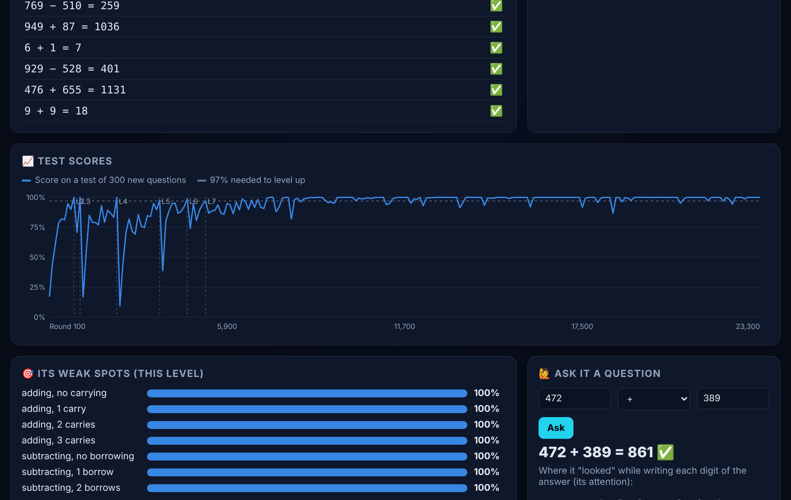

# 🧠 Pi Self-Learning AI

Three ways an AI can **teach itself**, all running on a Raspberry Pi:

| | Part | What happens |
|---|---|---|
| 🧮 | **The self-taught math AI** | A tiny GPT (the same kind of AI as ChatGPT, a million times smaller) starts knowing nothing. It writes its own quiz questions, mostly about what it's worst at, answers them, and a calculator checks every answer. It goes from adding 1-digit numbers to adding and subtracting 3-digit numbers, all by itself. |
| 💬 | **The self-quizzing chatbot** | A small ready-made AI language model writes its own math word problems, Python checks the math, then it answers them. Wrong answers go into a notebook, and an experiment tests whether reading the notebook helps. |
| 🔬 | **The model-collapse experiment** | What happens when an AI learns only from its own writing? Round after round, its sentences get stranger and more repetitive, unless you keep real writing in the mix. |

The big idea: **an AI can only teach itself if something checks its work.** Parts 1 and 2 have a checker. Part 3 shows what happens without one.



## Features
- **🧮 Watch it quiz itself, live:** every question it asks itself, its answer and ✅ or ❌, plus its 📒 notebook of mistakes.
- **📈 Test scores and levels:** 7 levels. It moves up when it scores 97% on a test of new questions.
- **🎯 Its weak spots:** how good it is at each kind of question (like "adding with 2 carries"). It practices the weak ones more.
- **🙋 Ask it a question:** see its answer and its **attention**: which digits it looked at while writing each digit of the answer.
- **💬 Chatbot practice:** watch a real language model write and solve its own problems, and see whether its notebook helps.
- **🔬 Collapse experiment:** run it with and without real facts, and compare the charts.
- Built from scratch in plain Python and numpy (no PyTorch), so you can read every step. It saves its progress, rests if the Pi gets too hot, and starts by itself when the Pi boots.

## 👉 New here? [Start with the checklist](docs/00-start-here.md)

## Guides
| # | Guide | What you'll learn |
|---|---|---|
| 0 | [**Start here**](docs/00-start-here.md) | The whole project as one checklist |
| 1 | [Install it](docs/01-install.md) | Install, open, update, uninstall |
| 2 | [The self-taught math AI](docs/02-math-ai.md) | How a tiny GPT works, how it quizzes itself, attention, and why it writes answers backward |
| 3 | [The self-quizzing chatbot](docs/03-chatbot.md) | Setting up a real language model on the Pi (Ollama or llama.cpp), and the notebook experiment |
| 4 | [The collapse experiment](docs/04-collapse-experiment.md) | What we found, and things to try |
| 5 | [Troubleshooting](docs/05-troubleshooting.md) | Problems and fixes |
| 6 | [Build log](docs/06-build-log.md) | The real problems we hit while building it |

## Quick install
```bash
sudo apt update
sudo apt install -y git python3-numpy
git clone https://github.com/akshajtripathi24-ui/pi-self-learning-ai ~/selflearning
cd ~/selflearning
bash setup-autostart.sh
```
Then open **http://raspberrypi.local:8100** (or `http://YOUR-PI-IP:8100`). The chatbot needs one more step: see [3. The chatbot](docs/03-chatbot.md).

**Update later:** `cd ~/selflearning && git pull && sudo systemctl restart selflearning`

It uses port **8100**, so it runs next to the [Pi Stock Tracker](https://github.com/akshajtripathi24-ui/pi-stock-tracker) (8000), the [Pi Space Station Tracker](https://github.com/akshajtripathi24-ui/pi-space-station-tracker) (8080) and [Pi Docking AI](https://github.com/akshajtripathi24-ui/pi-docking-ai) (8090).

## Files
| File | What it is |
|---|---|
| `tinygpt.py` | The tiny GPT: attention, the neural network, backpropagation and the Adam optimizer, written out by hand |
| `selfmath.py` | Part 1: the math AI's self-quizzing, checking, notebook and levels |
| `chatbot.py` | Part 2: the teacher, checker, student and notebook, talking to Ollama or llama.cpp |
| `collapse.py` | Part 3: the model-collapse experiment |
| `facts.txt` | 100 true space and robot facts, the starting sentences for part 3 |
| `server.py` | Runs everything and serves the website |
| `index.html` | The website |
| `setup-autostart.sh` | Makes it start by itself when the Pi boots |
| `setup-llamacpp.sh` | For 32-bit Pi OS: builds llama.cpp and downloads the chat model |
| `data/` | Made on your Pi: the math AI's brain, its progress, the experiments and the chatbot's notebook. Never uploaded to GitHub |

## Good to know
- **No accounts and no internet needed** for parts 1 and 3. Part 2 downloads a model once (about 400–500 MB), then runs on the Pi.
- **Keep it on your home network.** Don't forward ports on your router.
- A student learning project. The chat model in part 2 is [Qwen 2.5](https://huggingface.co/Qwen/Qwen2.5-0.5B-Instruct) (Apache 2.0 license).

## License
MIT. See [LICENSE](LICENSE).
