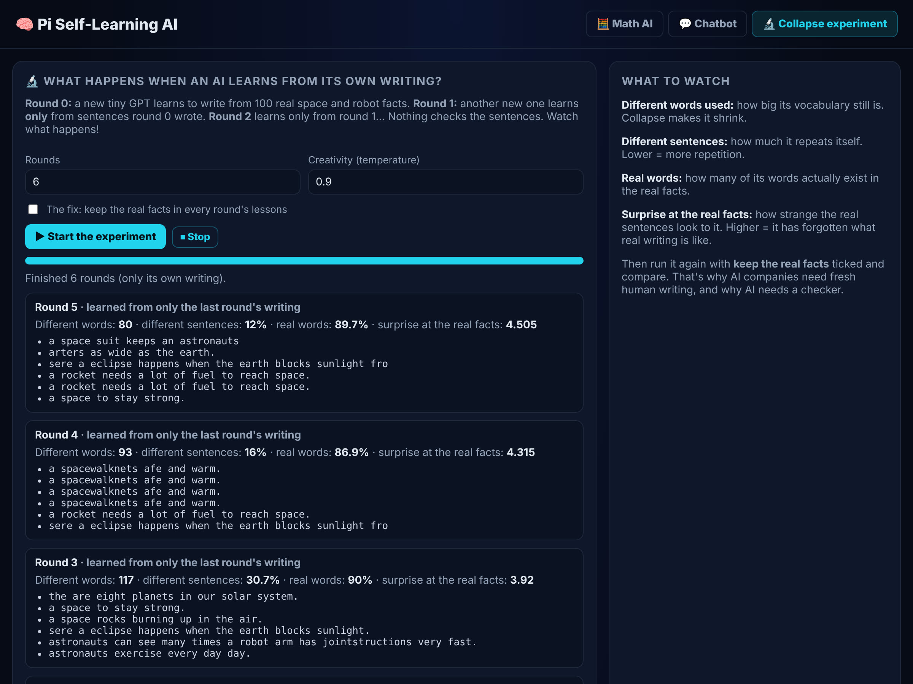

# 4. The model-collapse experiment

## The question
More and more of the internet is written by AI. If new AIs learn from that writing, they're learning from other AIs' mistakes. **What happens when an AI learns only from AI writing?**

## The experiment
- **Round 0:** a brand-new tiny GPT learns to write from **100 real space and robot facts** (`facts.txt`), one letter at a time. Then it writes 150 sentences of its own.
- **Round 1:** another brand-new tiny GPT learns **only** from round 0's sentences. Then it writes 150.
- **Round 2:** learns only from round 1's sentences, and so on.

Nothing checks the sentences, so every round's mistakes become the next round's lessons.

## What we found (6 rounds, on a fast computer)
| | Round 0 | Round 5, only its own writing | Round 5, real facts kept |
|---|---|---|---|
| Different words it used | 244 | **84** | 277 |
| Different sentences | 64% | **22%** (repeats itself) | 75% |
| Surprise at the real facts | 0.21 | **4.81** (forgot what they look like) | 0.26 |

By round 5 it wrote things like *"the tars yepthesphes gaell tfown y suar fom stake dof w."*, or repeated the same few sentences again and again. Researchers call this **model collapse**.

**The fix:** tick **keep the real facts in every round's lessons**. Then each round learns from its own writing *plus* the 100 real facts. In our test, it stayed healthy for all 5 rounds.

Your results will be a bit different every time, because the AI uses random numbers. That's normal. Run it a few times!

## Things to try
- **Creativity (temperature):** at 0.5 it plays it safe and repeats itself sooner. At 1.2 it takes more risks and makes up stranger words. Which collapses faster?
- **More rounds:** what does round 10 look like?

## How long it takes
Each round trains a new AI from scratch: about 35 seconds on a fast computer, so roughly 3–6 minutes on a Pi 4. Six rounds take about half an hour. It runs in the background, so you can close the page.

**Next:** [5. Troubleshooting](05-troubleshooting.md)
